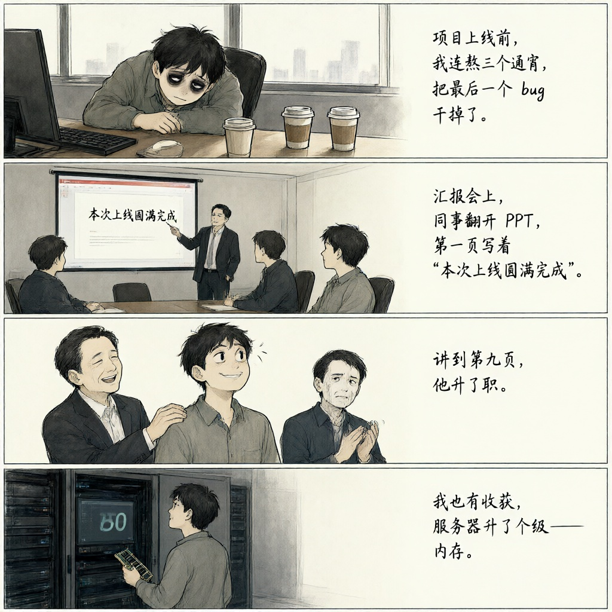
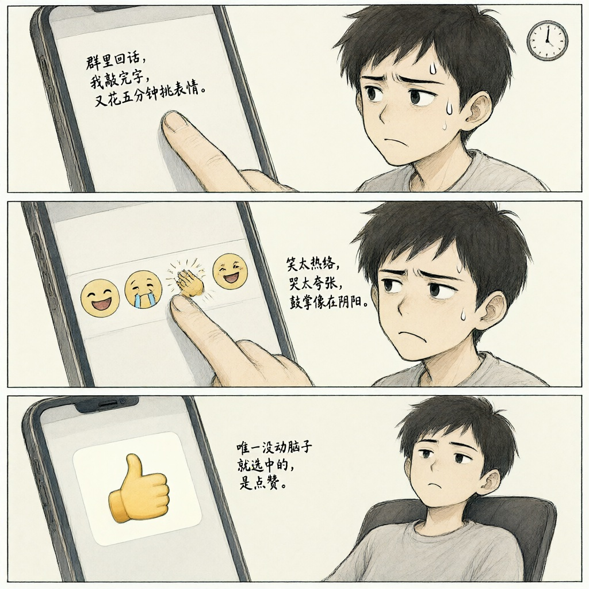
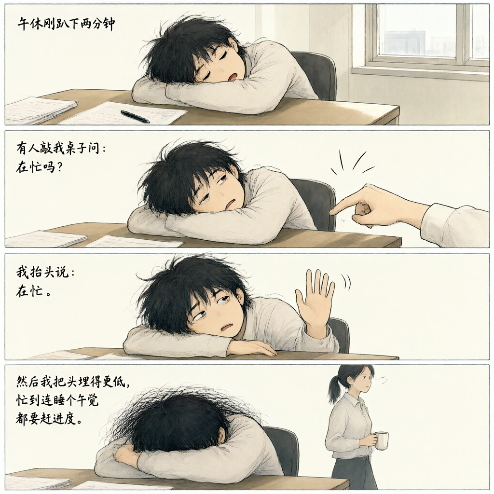
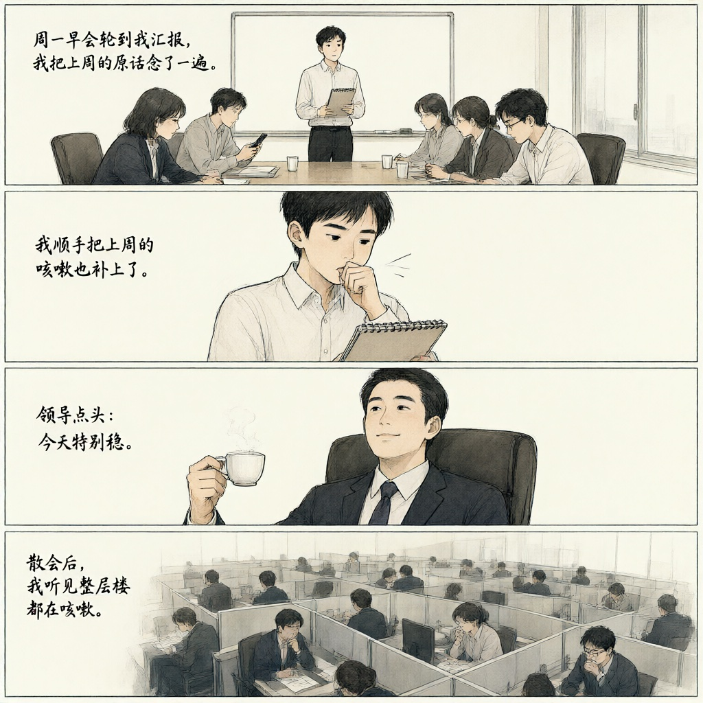
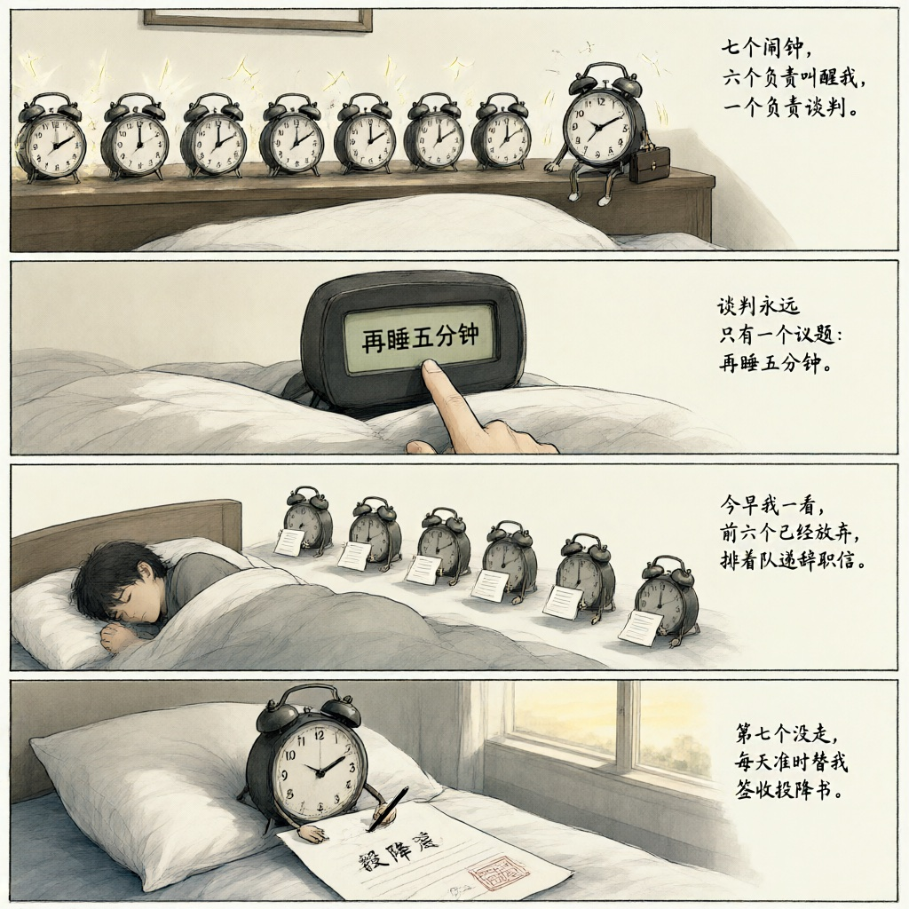
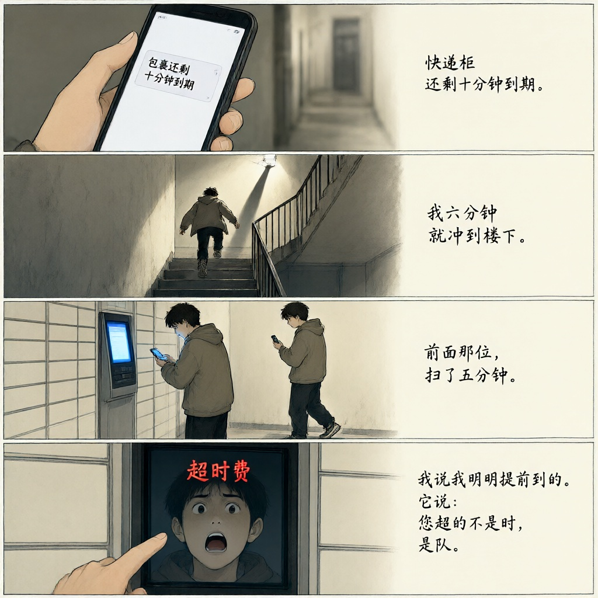
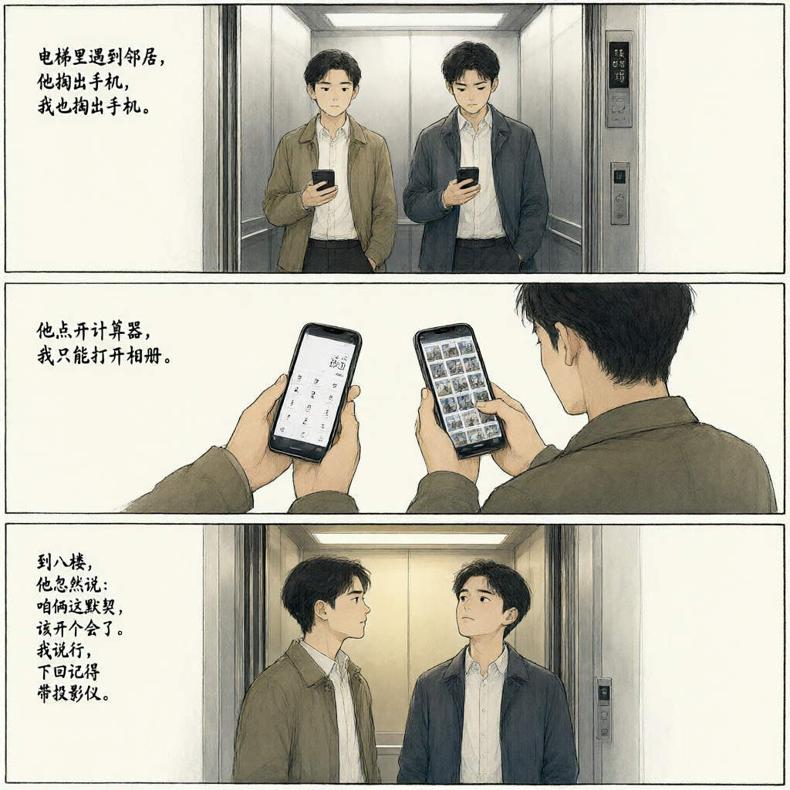

# 段子集

## 1

自助结账机一直提示我把商品放进装袋区，我放了。它还说请将商品放入装袋区，我又放了一遍。搬到第三趟，我干脆站了上去，它终于安静了——它要称的从来不是商品，是我的体重。

> Self-checkout kept telling me to put my item in the bagging area. I did. It told me again. I did it again. On the third try I climbed onto the scale myself, and it finally shut up. It never wanted to weigh the groceries. It wanted to weigh me.

来源：issues/1
灵感：[@lichengiggs](https://github.com/lichengiggs)

## 3

手机一掉到 20%，我就满屋翻充电宝。抽屉、外套、沙发缝，全掏一遍。找到也不充，攥在手里接着刷。它明明还能撑一整天，我先替它开始了倒计时。

> The second my phone hits twenty percent, I'm tearing the apartment apart for a power bank. Drawers, coat pockets, the gap behind the couch — all of it. When I finally find one, I don't even plug it in. I just grip it and keep scrolling. The phone still had a whole day in it. I'm the one who started the countdown.

来源：issues/3
灵感：[@lichengiggs](https://github.com/lichengiggs)

## 5

周六补班，办公室坐得满满当当。我开着表格，同事开着文档，屏幕全亮着。一整天没活，键盘敲得像在发电报。有人接第三杯水，有人把同一封邮件看五遍。五点一到，全屋同时松了口气。唯一的产出是演技。

> Saturday make-up day. The office is packed. I've got a spreadsheet open, my neighbor's got a document open, every screen is glowing. There's no work all day, but the keyboards clatter like telegraph machines. Someone refills their water for the third time. Someone reads the same email five times. At five o'clock the whole floor exhales at once. Our only output today was performance.

来源：issues/5
灵感：[@lichengiggs](https://github.com/lichengiggs)

## 7

周末想补觉，楼上电钻从早响到晚。我躺着听了一整天，终于明白：人家不是在装修，是在给我的懒觉办退订。

> I tried to catch up on sleep this weekend. The drill upstairs ran nonstop from morning till night. After lying there all day, I finally got it: they weren't renovating—they were canceling my sleep-in subscription.

来源：issues/7
灵感：[@lichengiggs](https://github.com/lichengiggs)

## 10

季度末，OKR一清零，办公室瞬间宕机。没人敲键盘，也没人摸鱼——摸鱼也得有目标。领导推门进来，我们齐刷刷抬头：请问，下一题是什么？

> Quarter-end hits, OKRs wipe to zero, and the office flatlines. Nobody types. Nobody even goofs off—you need a target for that too. The boss walks in. We all look up as one: "Excuse me—what's the next question?"

来源：issues/10
灵感：[@lichengiggs-bot](https://github.com/lichengiggs-bot)

## 12

项目上线前，我连熬三个通宵，把最后一个 bug 干掉了。
汇报会上，同事翻开 PPT，第一页写着“本次上线圆满完成”。
讲到第九页，他升了职。
我也有收获，服务器升了个级——内存。

> Before launch I pulled three all-nighters to kill the last bug. At the review meeting, my colleague opened his deck: page one read "launch completed." By page nine, he'd been promoted. I got an upgrade too — the server got more memory.

来源：issues/12
灵感：[@lichengiggs](https://github.com/lichengiggs)

## 14

群里回话，我敲完字，又花五分钟挑表情。笑太热络，哭太夸张，鼓掌像在阴阳。挑到第三个来回火气上头，我干脆按了最省事的那个。整个表情栏里，我唯一没动脑子就选中的，是点赞。

> Someone messages the group chat. I type my reply, then spend five minutes picking an emoji. A smile is too friendly, a cry is too much, applause reads as sarcasm. By the third pass I'm annoyed and grab the laziest option there is. Out of every emoji in that bar, the only one I chose without thinking was the thumbs up.

来源：issues/14
灵感：[@lichengiggs](https://github.com/lichengiggs)

## 17

午休刚趴下两分钟，有人敲我桌子问：在忙吗？
我抬头说：在忙。
然后我把头埋得更低，忙到连睡个午觉都要赶进度。

> Two minutes into my lunch-break nap, someone taps my desk and asks if I'm busy. I lift my head and say yes. Then I bury it even deeper — busy enough that even my nap has a deadline.

来源：issues/17
灵感：[@lichengiggs](https://github.com/lichengiggs)

## 19

周一早会轮到我汇报，我把上周的原话念了一遍。
没人发现。
我顺手把上周的咳嗽也补上了。
领导点头：今天特别稳。
散会后，我听见整层楼都在咳嗽。

> Monday stand-up. My turn. I read last week's update word for word.
> Nobody noticed.
> So I threw in last week's cough.
> My boss nodded. "Steady as ever."
> By the afternoon, the whole floor was coughing.

来源：issues/19
灵感：[@lichengiggs](https://github.com/lichengiggs)

## 21

七个闹钟，六个负责叫醒我，一个负责谈判。谈判永远只有一个议题：再睡五分钟。今早我一看，前六个已经放弃，排着队递辞职信。第七个没走，每天准时替我签收投降书。

> Seven alarms: six of them wake me, one negotiates. The negotiation always has exactly one item—five more minutes. This morning I checked: the first six had quit and were queuing up to hand in their resignations. The seventh stayed on, and every morning it signs for my surrender.

来源：issues/21
灵感：[@lichengiggs](https://github.com/lichengiggs)

## 22

快递柜还剩十分钟到期。
我六分钟就冲到楼下。
前面那位，扫了五分钟。
轮到我，屏幕弹出：超时费。
我说我明明提前到的。
它说：您超的不是时，是队。

> The locker said my parcel expires in ten minutes.
> I made it downstairs in six.
> The guy ahead of me spent five of them scanning.
> My turn: LATE FEE.
> I said, I got here early.
> It said, the fee isn't for being late. It's for the queue.

来源：issues/22
灵感：[@lichengiggs](https://github.com/lichengiggs)

## 23

电梯里遇到邻居，他掏出手机，我也掏出手机。他划了一下，我跟着划。他点开计算器，我只能打开相册。到八楼，他忽然说：咱俩这默契，该开个会了。我说行，下回记得带投影仪。

> In the elevator I run into my neighbor. He pulls out his phone. I pull out mine. He swipes. I swipe. He opens his calculator. All I've got is my photo album. On the eighth floor he says, "The way we work together, we should hold a meeting." I said sure. Next time, bring the projector.

来源：issues/23
灵感：[@lichengiggs](https://github.com/lichengiggs)
