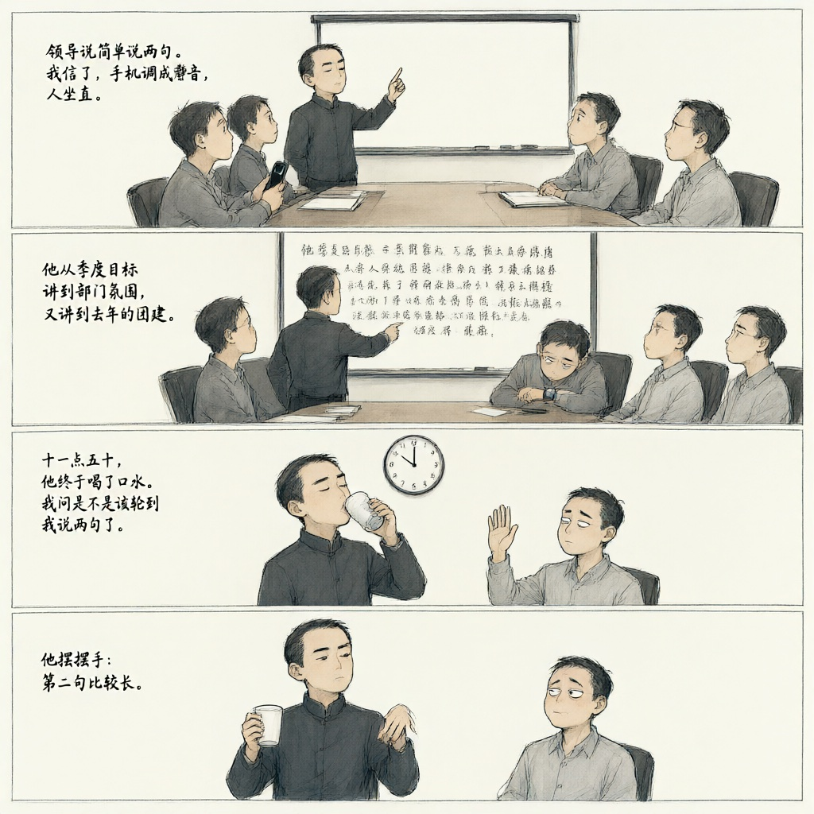
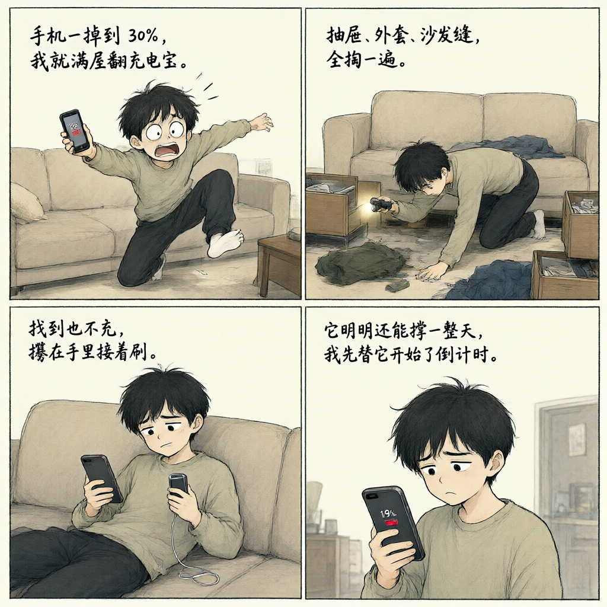
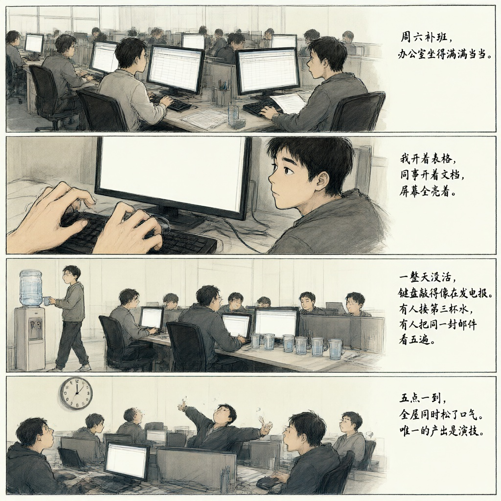
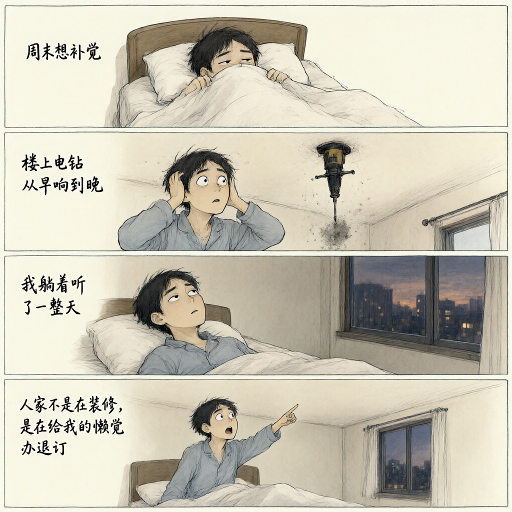
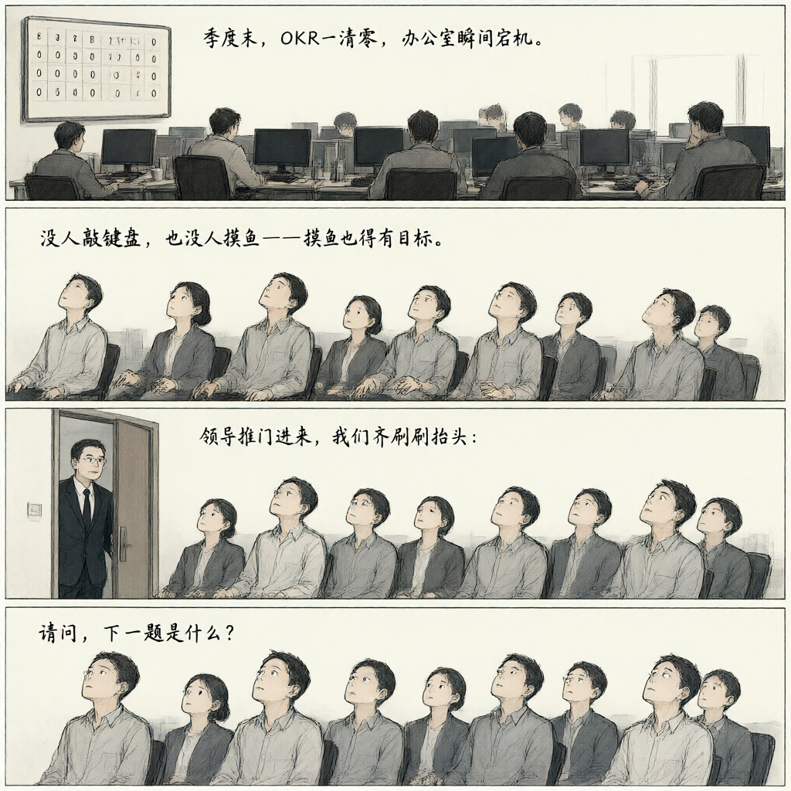

# 段子集

## 1

自助结账机一直提示我把商品放进装袋区，我放了。它还说请将商品放入装袋区，我又放了一遍。搬到第三趟，我干脆站了上去，它终于安静了——它要称的从来不是商品，是我的体重。

> Self-checkout kept telling me to put my item in the bagging area. I did. It told me again. I did it again. On the third try I climbed onto the scale myself, and it finally shut up. It never wanted to weigh the groceries. It wanted to weigh me.

来源：issues/1
灵感：[@lichengiggs](https://github.com/lichengiggs)

## 3

手机一掉到 20%，我就满屋翻充电宝。抽屉、外套、沙发缝，全掏一遍。找到也不充，攥在手里接着刷。它明明还能撑一整天，我先替它开始了倒计时。

> The second my phone hits twenty percent, I'm tearing the apartment apart for a power bank. Drawers, coat pockets, the gap behind the couch — all of it. When I finally find one, I don't even plug it in. I just grip it and keep scrolling. The phone still had a whole day in it. I'm the one who started the countdown.

来源：issues/3
灵感：[@lichengiggs](https://github.com/lichengiggs)

## 5

周六补班，办公室坐得满满当当。我开着表格，同事开着文档，屏幕全亮着。一整天没活，键盘敲得像在发电报。有人接第三杯水，有人把同一封邮件看五遍。五点一到，全屋同时松了口气。唯一的产出是演技。

> Saturday make-up day. The office is packed. I've got a spreadsheet open, my neighbor's got a document open, every screen is glowing. There's no work all day, but the keyboards clatter like telegraph machines. Someone refills their water for the third time. Someone reads the same email five times. At five o'clock the whole floor exhales at once. Our only output today was performance.

来源：issues/5
灵感：[@lichengiggs](https://github.com/lichengiggs)

## 7

周末想补觉，楼上电钻从早响到晚。我躺着听了一整天，终于明白：人家不是在装修，是在给我的懒觉办退订。

> I tried to catch up on sleep this weekend. The drill upstairs ran nonstop from morning till night. After lying there all day, I finally got it: they weren't renovating—they were canceling my sleep-in subscription.

来源：issues/7
灵感：[@lichengiggs](https://github.com/lichengiggs)

## 10

季度末，OKR一清零，办公室瞬间宕机。没人敲键盘，也没人摸鱼——摸鱼也得有目标。领导推门进来，我们齐刷刷抬头：请问，下一题是什么？

> Quarter-end hits, OKRs wipe to zero, and the office flatlines. Nobody types. Nobody even goofs off—you need a target for that too. The boss walks in. We all look up as one: "Excuse me—what's the next question?"

来源：issues/10
灵感：[@lichengiggs-bot](https://github.com/lichengiggs-bot)
