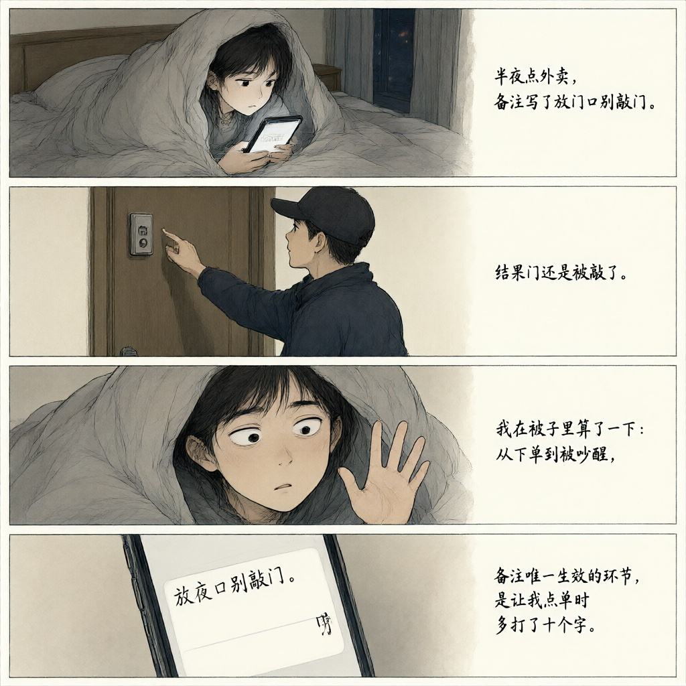
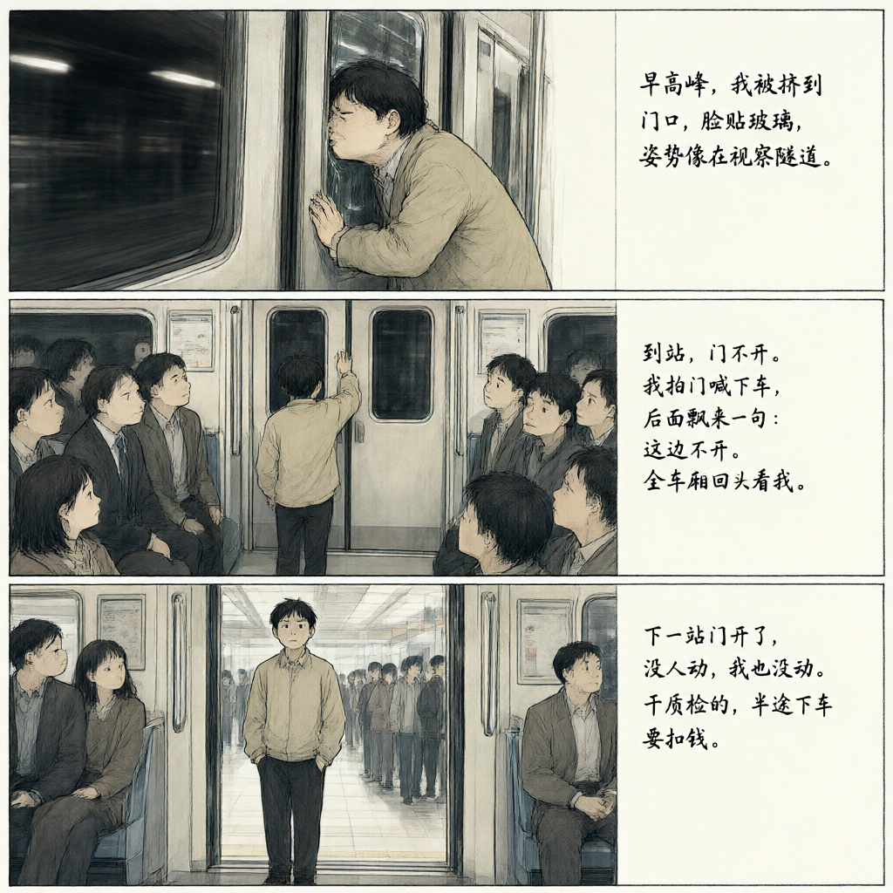
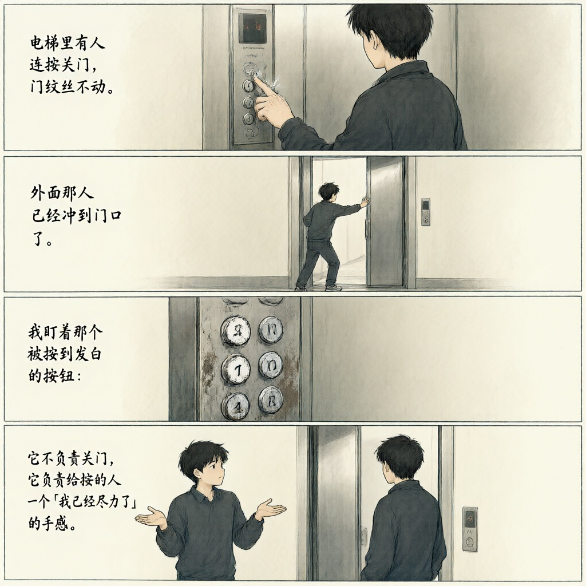
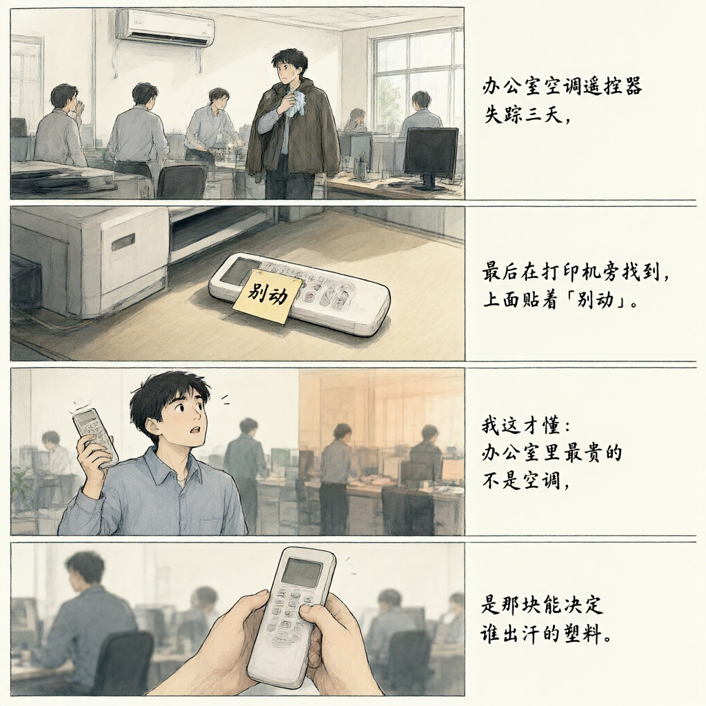
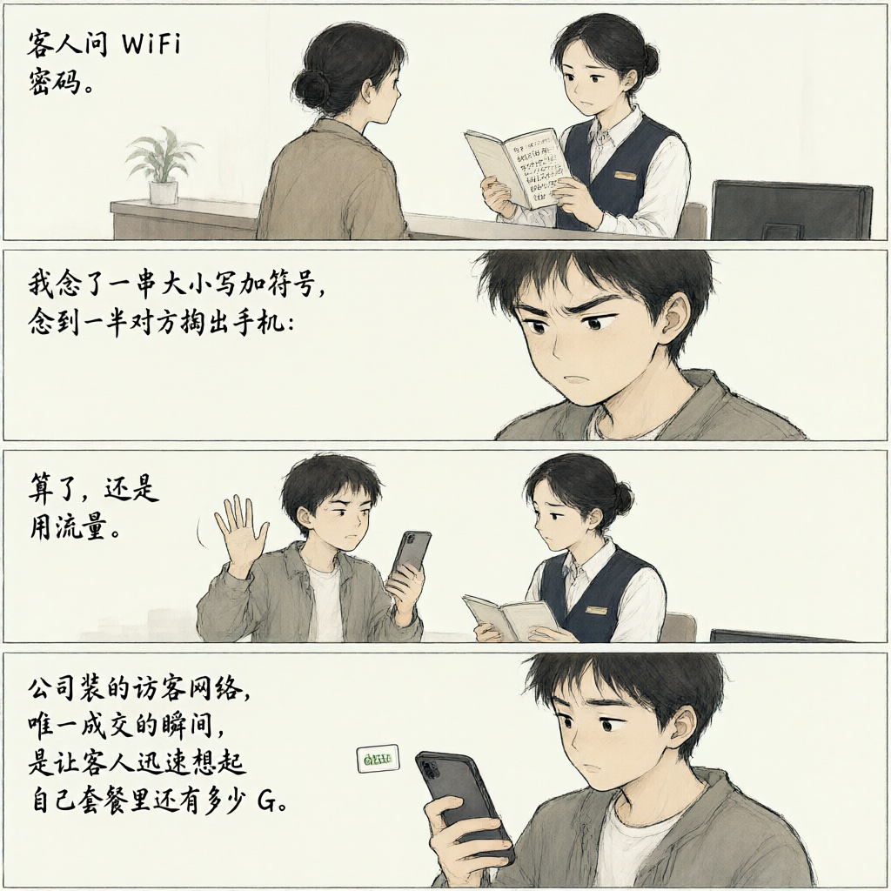

# 段子集

## 44

半夜点外卖，备注写了放门口别敲门。结果门还是被敲了。我在被子里算了一下：从下单到被吵醒，备注唯一生效的环节，是让我点单时多打了十个字。

> I ordered late-night delivery and wrote: leave it at the door, don't knock. They knocked anyway. Under the covers I did the math—from checkout to wake-up call, the only thing those notes accomplished was making me type ten extra characters.

来源：issues/44
灵感：[@lichengiggs](https://github.com/lichengiggs)

## 51

早高峰，我被挤到门口，脸贴玻璃，姿势像在视察隧道。到站，门不开。我拍门喊下车，后面飘来一句：这边不开。全车厢回头看我。我清清嗓子：我不是要下车，我在测门的密封性。下一站门开了，没人动，我也没动。干质检的，半途下车要扣钱。

> Rush hour. I get squeezed against the door, face on the glass, like I'm inspecting the tunnel. Train stops. Door doesn't open. I bang on it, yell "letting off!" Someone behind me says, "Wrong side." Whole car turns around. I clear my throat: "I'm not getting off. I'm testing the seal." Next stop, the door opens, nobody moves. Neither do I. In quality control, leaving mid-shift gets you docked.

来源：issues/51
灵感：[@lichengiggs](https://github.com/lichengiggs)

## 53

电梯里有人连按关门，门纹丝不动。外面那人已经冲到门口了。我盯着那个被按到发白的按钮：它不负责关门，它负责给按的人一个「我已经尽力了」的手感。

> Someone in the elevator mashes the door-close button. The door doesn't budge. The person outside is already at the threshold. I stare at that button worn pale: it doesn't close doors—it gives the masher the feeling of having tried their best.

来源：issues/53
灵感：[@lichengiggs](https://github.com/lichengiggs)

## 54

办公室空调遥控器失踪三天，最后在打印机旁找到，上面贴着「别动」。我这才懂：办公室里最贵的不是空调，是那块能决定谁出汗的塑料。

> The office AC remote went missing for three days. We found it by the printer, sticky note attached: "Don't touch." That's when I got it—the most expensive thing in the office isn't the air conditioner. It's the scrap of plastic that decides who sweats.

来源：issues/54
灵感：[@lichengiggs](https://github.com/lichengiggs)

## 55

客人问 WiFi 密码。我念了一串大小写加符号，念到一半对方掏出手机：算了，还是用流量。公司装的访客网络，唯一成交的瞬间，是让客人迅速想起自己套餐里还有多少 G。

> A guest asks for the WiFi password. I start reciting a string of mixed case and symbols. Halfway through they pull out their phone: forget it, I'll use data. The only deal our guest network ever closes is reminding visitors how many gigs they still have left.

来源：issues/55
灵感：[@lichengiggs](https://github.com/lichengiggs)
